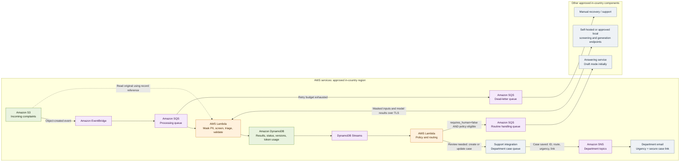
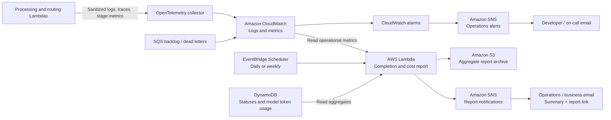

# Example AWS architecture: asynchronous complaint triage

This maps the [production memo](Production_Design_Memo.md) to concrete services
using the proposed S3, event, queue, Lambda, DynamoDB and SNS flow. The model
endpoint, support case system and answering service remain generic so they can
use approved in-country infrastructure. This is an illustrative deployment
architecture, not deployed infrastructure.

## Complaint processing and routing

1. **Ingest and buffer.** Store each incoming record in S3. Object-created
   events go through EventBridge to SQS, carrying a record reference rather
   than the narrative. Lambda consumes the queue with bounded concurrency;
   the queue absorbs bursts while respecting local model capacity.
   [S3 event destinations](https://docs.aws.amazon.com/AmazonS3/latest/userguide/notification-how-to-event-types-and-destinations.html),
   [SQS/Lambda processing](https://docs.aws.amazon.com/lambda/latest/dg/with-sqs.html).
2. **Process and persist.** The worker masks identifiers locally before any
   model call, screens for injection, generates and validates triage, then saves
   the decision and processing state. Screening failures or invalid responses
   that exhaust model retries produce a saved human-review fallback. Unhandled
   worker failures retry through SQS and eventually enter the dead-letter queue.
3. **Route after a durable result.** DynamoDB Streams invokes a routing Lambda
   on a completed decision. It applies escalation rules, creates the support
   case and then publishes a minimal notification to the category's SNS topic.
   Urgency is included in the notice and case priority. Filter stream events to
   avoid routing again when only delivery metadata changes.
   [DynamoDB Streams and Lambda](https://docs.aws.amazon.com/amazondynamodb/latest/developerguide/Streams.Lambda.html),
   [SNS email subscriptions](https://docs.aws.amazon.com/sns/latest/dg/sns-email-notifications.html).
4. **Separate routine handling.** Only a false human-review flag plus a validated
   low-risk policy permits the routine queue. An answering service can consume
   this queue, initially producing drafts for approval. Customer-visible
   automatic responses and closure require their own later validation.

Use complaint/version keys, conditional writes and delivery records so retries
do not create duplicate cases or repeat model calls unnecessarily. The support
case queue is authoritative; email is an alert, not proof of case acceptance.
Configure failed stream deliveries for recovery as well as SQS dead letters,
and reconcile stored complaints against completed results and routed cases.

## Monitoring, alerts and scheduled reporting

Set warning/error severity in compute logs and alert on failure thresholds,
oldest-job age, dead letters and routing-delivery failures. Keep complaint text,
model prompts/responses and secrets out of logs and traces. Daily/weekly reports
summarize completed, failed, deferred and outstanding jobs, retries, latency,
model calls, input/output tokens and estimated spend. Missing usage remains
explicitly unknown. The reporting Lambda uses aggregated records; it does not
email narratives. Scheduling uses an
[EventBridge Scheduler Lambda target](https://docs.aws.amazon.com/scheduler/latest/UserGuide/managing-targets.html).

## Controls applying to both diagrams

AWS service and region availability, model hosting, telemetry, backups, support
access and email delivery must all satisfy PayGuard's in-country requirements.
If a component cannot meet them, replace it with an approved domestic equivalent;
do not assume a nearby region or a global model API is acceptable. Configure TLS,
encryption at rest, least-privilege IAM roles, protected keys and approved
retention/lifecycle policies. Masking complements these controls and does not
replace residency approval. Human-review rollout gates and rollback behavior
remain those in the production memo.
