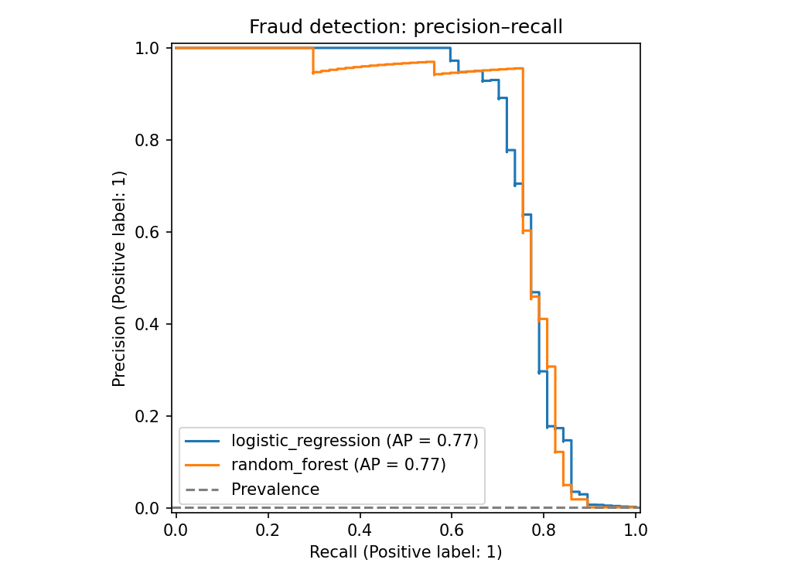
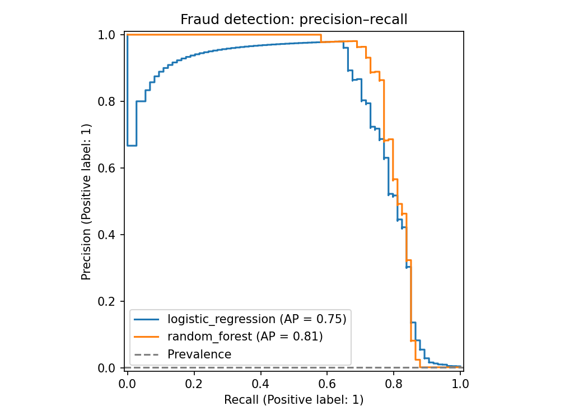
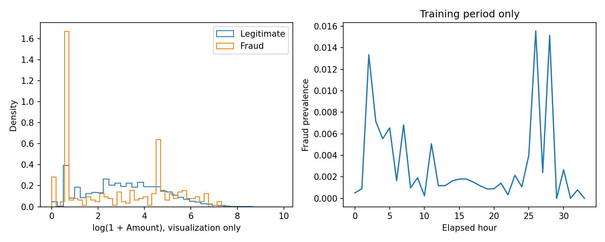

# Part A: measured results

Generated from frozen validation decisions; no test-based tuning.

Dataset SHA-256: `76274b691b16a6c49d3f159c883398e03ccd6d1ee12d9d8ee38f4b4b98551a89`.
Source rows: 284,807; exact duplicates removed: 1,081.

| Partition | Rows | Fraud | Prevalence | Time range (seconds) | Earlier feature repeats |
|---|---:|---:|---:|---|---:|
| train | 170,235 | 342 | 0.2009% | 0–120392 | 0 |
| validation | 56,745 | 57 | 0.1004% | 120393–145233 | 561 |
| test | 56,746 | 74 | 0.1304% | 145234–172792 | 1720 |

| Model | Validation AP | Validation cost | Test AP | ROC AUC | Threshold | Precision | Recall | FP | FN | Alerts | Cost / 1,000 |
|---|---:|---:|---:|---:|---:|---:|---:|---:|---:|---:|---:|
| logistic_regression | 0.7727 | 1425 | 0.7466 | 0.9819 | 0.999619 | 72.37% | 74.32% | 21 | 19 | 76 | 35.33 |
| random_forest | 0.7692 | 1410 | 0.8062 | 0.9346 | 0.324505 | 87.50% | 75.68% | 8 | 18 | 64 | 32.43 |
| always_legitimate | 0.0010 | 5700 | 0.0013 | 0.5000 | 1 | 0.00% | 0.00% | 0 | 74 | 0 | 130.41 |

Selected on validation: **random_forest**, threshold **0.324504778**.
FP cost = 5; FN cost = 100 hypothetical units.
Flags request human review. These costs are assumptions, not PayGuard measurements.

## Validation sensitivity

Each row reselects the model and threshold on validation only. The default policy stays frozen.

| FN/FP cost ratio | Selected model | Threshold | Precision | Recall | Alerts |
|---|---|---:|---:|---:|---:|
| 10 | random_forest | 0.324505 | 95.56% | 75.44% | 45 |
| 20 | random_forest | 0.324505 | 95.56% | 75.44% | 45 |
| 50 | random_forest | 0.0664469 | 30.72% | 82.46% | 153 |

## Runtime

Selected pipeline, warm single-row inference: p50 18.42 ms; p95 32.10 ms, 100 calls, one inference worker.
Includes DataFrame feature selection and fitted preprocessing; excludes CSV reading, feature retrieval and network latency. This is not a service latency guarantee.

Training times: logistic_regression: 1.39 s; random_forest: 108.53 s.

## Interpretation limits

Test estimates use only the fraud counts shown above, from a short historical period. No confidence interval or independence across fraud episodes is established. Feature repeats may represent genuine events; without entity IDs we cannot isolate cards or episodes. Higher scores are not established fraud probabilities. See the Part A README for methodology, costs and real-time constraints.

