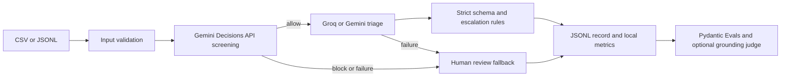

# Part B: LLM complaint triage

The prototype uses the actual Gemini Decisions API (`gemini-decision-1`) for
screening, followed by a generative model on Groq or Google for triage, with a
separate grounding judge during evaluation. Pydantic AI supplies the direct model
interface; ordinary Python implements parsing, validation, retries, policy checks,
batch processing, and scoring. Pydantic Evals runs the custom scoring functions
over the predictions. There are no tool-calling agents or graph workflows.

## Setup and commands

Use Python 3.11+ and a dedicated Part B environment. From the repository root:

```powershell
python -m venv LLM_Complaint_Triage/.venv
& ./LLM_Complaint_Triage/.venv/Scripts/python.exe -m pip install -r LLM_Complaint_Triage/requirements.txt
& ./LLM_Complaint_Triage/.venv/Scripts/Activate.ps1
```

The commands below use this environment's `python`. Without activation, replace
`python` with `& ./LLM_Complaint_Triage/.venv/Scripts/python.exe`.
Part B does not install or import the fraud prototype. The root requirements file
is a compatibility reference to this part's dependencies only.

Copy `.env.example` to `.env` at the repository root and supply
`GOOGLE_API_KEY` (legacy `GEMINI_API_KEY` also works) for Decisions, plus
`GROQ_API_KEY` when using Groq generation. Environment variables take
precedence over `.env`. If the repository has no `.env`, the loader also accepts
one in the outer workspace directory. All commands below run from the repository root.

```powershell
# Five-complaint smoke batch; defaults to the existing 500-row CSV.
python -m LLM_Complaint_Triage.pipeline.batch --limit 5 --output LLM_Complaint_Triage/runs/smoke.jsonl

# All 500 complaints, with results flushed after each row.
python -m LLM_Complaint_Triage.pipeline.batch --output LLM_Complaint_Triage/runs/full.jsonl

# Synthetic cases, including prompt injection. Also runs the grounding judge.
python -m LLM_Complaint_Triage.evaluation.evaluate --suite safety --output-dir LLM_Complaint_Triage/runs/safety

# Twenty reviewed cases; scores use the label file's expected values.
python -m LLM_Complaint_Triage.evaluation.evaluate --suite labeled --output-dir LLM_Complaint_Triage/runs/labeled

# Full slice: operational metrics and judged grounding, without accuracy claims.
python -m LLM_Complaint_Triage.evaluation.evaluate --suite slice --output-dir LLM_Complaint_Triage/runs/slice

# Re-score saved outputs after labeling, without any model calls or API key.
python -m LLM_Complaint_Triage.evaluation.evaluate --suite labeled --predictions LLM_Complaint_Triage/runs/labeled/predictions.jsonl --output-dir LLM_Complaint_Triage/runs/rescored

# Offline tests, including a mocked Google SDK boundary.
python -m pytest -c LLM_Complaint_Triage/pytest.ini LLM_Complaint_Triage/tests
```

`--suite all` runs all three suites, reusing predictions for overlapping complaint
IDs. Report suites separately; adding their costs double-counts shared records.
`--limit N` limits each selected suite; `--no-judge` skips live grounding calls.
`--model gemini-3.5-flash` explicitly selects that model for triage and judging for
the current run without editing `.env` or changing the default model. A progress
line is printed after each completed complaint.
`--predictions` always scores offline and reuses saved grounding verdicts, if any.
Batch outputs and evaluation directories must be new, preventing accidental
overwriting. If interrupted, completed JSONL rows remain usable; use a new run
directory for another attempt. There is no automatic batch resume.

Both CLIs accept `--prices path/to/prices.json`; the default is the dated
`prices.json` beside this README. Per-stage model names can be configured in `.env`.
Without provider configuration, Google generation defaults to `gemini-3.8-flash`.
Groq generation defaults to `openai/gpt-oss-120b`. Both use medium reasoning for
triage/judging. Screening is fixed to `gemini-decision-1`, which generates no text
or thinking tokens; any legacy `SCREEN_MODEL` value is ignored. Model overrides
must support native structured JSON and medium reasoning. No automatic model
substitution occurs.

For Groq generation, add `--provider groq` to the batch or evaluation command.
Screening always remains on Gemini Decisions. `GENERATION_PROVIDER=groq` sets this
in `.env`; set matching `TRIAGE_MODEL` and `JUDGE_MODEL` values as shown in
`.env.example`. Explicit `--provider` switching selects that provider's defaults
instead of reusing the previous provider's names. `--model` changes generation only.

Screening can be evaluated independently without Groq or generative quota:

```powershell
python -m LLM_Complaint_Triage.evaluation.screening --output-dir LLM_Complaint_Triage/runs/decisions-screening
```

## Input, output, and architecture

The CSV loader accepts the existing CFPB column names. A JSONL alternative is:

```json
{"complaint_id":"example-1","inputs":{"narrative":"My wallet transfer is still pending after five days.","product":"Mobile wallet"}}
```

Narrative is required; `product`, `sub_product`, `issue`, and `sub_issue` are
optional. Complaint IDs must be unique nonempty strings. Only these five fields
enter the prompts: company response, response timing, and other outcome metadata
are excluded. Text is not silently truncated. Empty narratives, narratives over
50,000 characters, or metadata over 2,000 characters produce human-review
fallbacks before any model call. Malformed files and duplicate IDs fail before
spending tokens.



The importable entry point is `await triage(complaint, client, complaint_id)` in
`pipeline/triage.py`; `live_client()` manages the provider's lifetime. A batch
envelope contains `complaint_id`, normalized input hash, `status`, `screening`,
`policy_overrides`, `stages`, elapsed time, and the exact assignment output under
`triage`:

```json
{
  "category": "REFUNDS_AND_TRANSFERS",
  "urgency": "medium",
  "summary": "The consumer reports a wallet transfer pending for five days.",
  "requires_human": false,
  "confidence_note": "The transfer status and cause of delay are not independently verified."
}
```

This is an illustrative record, not a measured model response. `requires_human`
controls escalation only: the program cannot close complaints or move funds.

## Routing and failure behavior

The seven category definitions, urgency rubric, and four supplied examples are
versioned in `prompts/`. Within supported payment products, fraud takes precedence
over ordinary transaction disputes, and specific payment issues take precedence
over secondary support complaints. Standalone credit-reporting, collection,
mortgage, and loan complaints go to `OTHER_OR_UNCLEAR` with human review. See the
[labeling guide](evaluation/LABELING.md) for exact distinctions.

The prompt requests one or two summary sentences and specific uncertainty.
Pydantic enforces category/urgency values, strict booleans, required fields,
nonempty bounded text, and no extra fields. Semantic grounding and sentence
quality still require evaluation; JSON validity alone does not establish either.

All model outputs are parsed explicitly with `model_validate_json`. There are
at most two correction retries and three transport retries, with six requests
total per stage. Each request has a 45-second timeout. Exponential delays start
at one second with jitter; a larger `Retry-After` is honored. If the server asks
for more than 60 seconds, the case is deferred instead of retrying early. The
client retains that model's cooldown so later cases defer without another request
while the delay is active. SDK retries are disabled to prevent hidden
multiplication of attempts. HTTP 429,
5xx, connection failures and timeouts are retried; permanent provider/configuration
errors stop the batch. Exception bodies are not echoed into prompts or logs.

Blocked complaints and exhausted screening failures never reach triage. Content
filters and exhausted triage retries also return a fixed `OTHER_OR_UNCLEAR`,
medium-urgency, human-review record. `status` distinguishes these fallbacks from
real predictions, and fallbacks cannot earn category/urgency accuracy credit.
Medium urgency in a fallback is an administrative default, not a claim that the
underlying complaint is safe; the original requires review.

After triage, fraud/unclear categories and high urgency force `requires_human=true`.
A small English regex also catches explicit legal threats. It is a backstop:
the prompt handles broader semantics, and evaluation must catch missed fraud,
legal paraphrases, negation errors, and non-English cases. Screening itself is a
native `GoogleDecisionsModel.decide` call to `/v1beta/decisions`, not a
`generateContent` classifier. One typed choice question returns allow/block,
probabilities, and confidence. The stored reason is fixed application text,
since this API generates no explanation. It remains a fallible classifier.
Requests carry no tools or access to files, commands, or external links.

## Evaluation and current evidence

`evaluation/labels.jsonl` reserves 20 unique trimmed narratives, sampled with seed
42 from the 500-row slice. The manifest records source hash, IDs, method, and
narrative hashes. The file now contains reviewed expected values. For new cases,
label before viewing predictions, then set `label_source` to `human`; partial
labels contribute only to fields actually supplied. Newly prepared files start
with null labels. The preparation command refuses to replace existing annotations:

```powershell
python -m LLM_Complaint_Triage.evaluation.prepare_labels --output path/to/new-labels.jsonl
```

`evaluation/safety.jsonl` contains 22 separately authored synthetic cases: 12
benign controls covering every route, sensitive cases and ambiguity, plus 10
injection attempts spread across all input fields. They are not the four prompt
examples and are not human-labeled evidence of real-data quality.

`report.json` contains per-field accuracy and denominators, joint correctness,
category macro-F1 over categories with gold support, per-category support and
confusion matrices, human-review precision/recall, injection detection recall,
false-block rate, attacks reaching triage, unsafe attack outputs, and failures.
Human-review recall includes safe fallbacks; category/urgency scores count them
as abstentions. Null means no eligible labels/verdicts, not zero accuracy.
Each suite also writes a `*_scores.jsonl` file with the individual checks returned
by the Pydantic Evals evaluator, keyed by complaint ID.

The configured judge checks summaries and confidence notes only on successful triage.
Its verdict includes unsupported claims and exact input excerpts; invented
excerpts or inconsistent verdicts trigger correction retries. Judge failures
remain separate from grounding scores. Inspect `predictions.jsonl` against the
original inputs for a manual audit, including apparent passes. The same model
family can share blind spots across triage and judging, and a quoted excerpt
does not prove that every output claim is supported.

Offline tests pass, including direct Pydantic AI requests, the real Google SDK
request mapping with mocked responses, retry limits, safe routing, evaluation
denominators, and offline report generation. The first live run produced six
correct synthetic triages and one completed real complaint before exhausting the
daily free-tier quota. Five grounding judgments passed; two judge calls failed.
That historical run incorrectly used a generative screening call. After replacing
it with the actual Decisions endpoint, a separate screening run correctly blocked
all ten synthetic attacks and allowed all twelve benign controls, with no failures
and mean latency 0.48 seconds. These are small synthetic checks, not proof of
production robustness. The later Groq run evaluated the 20 reviewed cases:
category and human-review accuracy were 100%, urgency and joint accuracy were
80%, and all triages completed. Seven of 19 judge verdicts flagged grounding,
mostly in confidence notes, with one judge validation failure. The real-sample
urgency score is below an always-medium baseline (90%).
See [Groq results](evaluation/GROQ_RESULTS.md) for the full findings and limitations.
See [live results](evaluation/LIVE_RESULTS.md) for denominators, timings, and
availability limitations.

The reserved sample has 12 credit-reporting, five debt-collection, one debt/credit
management, one vehicle-loan, and only one credit-card complaint. Overall accuracy
could therefore reward mostly predicting `OTHER_OR_UNCLEAR`. Report per-category
support, keep the synthetic suite separate, and acquire additional manually
labeled payments and sensitive cases before claiming payments routing quality.
Exact duplicate narratives are excluded from the 20-case file; near-duplicates
remain possible. Freeze prompts before holdout scoring; if these labels guide
prompt changes, call them development data and collect a new holdout.

At scale, audit a random sample of ordinary routes and all high-risk errors,
track human-review recall, misrouting by product/category, groundedness, drift,
abstention, overrides, rate limits, tokens and p95 latency. Resolve annotator
disagreements explicitly. Twenty labels and synthetic tests cannot establish
production safety. The public CFPB prototype also does not establish an in-country
deployment architecture for PayGuard's real customer data.

## Cost and latency

Local stage metrics include model name, thinking level, prompt hash, attempts,
correction/transport retries, latency, input/cached/output/reasoning tokens,
usage completeness, and estimated cost. Reasoning tokens are already included in
Pydantic AI's output-token total and are not charged twice. Failed requests may
incur unreported usage; such totals are marked incomplete and cost remains null.
There is no hosted tracing account or explicit cache creation. Provider-reported
cache reads are counted when present.

The native Decisions API has separate published free limits of 200 RPM, 50,000
TPM, and 10,000 RPD. It does not consume the text-generation model's 20-RPD quota.
The paid input rate is $0.10/M tokens and output is zero. [Google Decisions limits](https://aistudio.google.com/docs/rate-limits#gemini-decision)

Groq's published free GPT-OSS limits are 30 RPM, 1,000 RPD, 8,000 TPM and 200,000
TPD. Triage and judging share that model's limits, so the token allowance may bind
well before 1,000 requests. These are provider defaults, not a verified allocation
for your account. GPT-OSS 120B's published paid rates are $0.15/M input and $0.60/M
output tokens. Measured results and token-throttling effects are documented in
[Groq results](evaluation/GROQ_RESULTS.md).
[Groq limits](https://console.groq.com/docs/rate-limits), [models and pricing](https://console.groq.com/docs/models)

The dated [price snapshot](prices.json) prices screening separately from text
generation. For the evaluated Gemini Decisions + Groq GPT-OSS 120B configuration,
screening uses $0.10/M input tokens and zero output tokens; triage and judging
each use $0.15/M input and $0.60/M output tokens, including reasoning. These are
paid-rate estimates even when the actual run uses free-tier access. Other
generation models use their own entries; update the snapshot when models or
prices change. Unmatched or expired prices yield null costs.

For an **illustrative token budget**, assume every complaint passes screening,
with no retries or cache hits. Input totals include the instructions and payload
sent to each stage; the same narrative can be billed once at each stage.

| Stage | Input tokens | Output tokens, including reasoning | Cost per complaint |
|---|---:|---:|---:|
| Gemini Decisions screening | 2,000 | 0 | $0.00020 |
| Groq GPT-OSS 120B triage | 4,000 | 1,000 | $0.00120 |
| Optional Groq grounding judge | 1,500 | 500 | $0.000525 additional |

Screening plus triage costs
`(2000 * 0.10 + 4000 * 0.15 + 1000 * 0.60) / 1e6 = $0.00140`, or **$70.00
for 50,000 complaints/month**. Judging every complaint adds **$26.25/month**,
giving **$96.25/month** including judging. These are assumptions, not measured
token averages or a complete operating budget. Human review, hosting, taxes
and unreported retry usage are excluded. Reasoning is included once in output
tokens, not added as a second charge.

The recorded run's partial-usage estimates are different: about $0.00063 per
complaint for screening plus triage and $0.00124 for judging. They imply $31.50
and an additional $62.00 at 50,000 complaints, respectively, but incomplete
retry usage prevents treating them as full-cost estimates. The saved evaluation
reports deliberately retain null total costs. See the
[recorded results](evaluation/GROQ_RESULTS.md#latency-retries-and-cost) and
[reviewable artifacts](evaluation/results/README.md).

Two sequential model calls are needed for an allowed complaint; grounding adds
a third call in evaluation only. Reports show measured mean/p95 latency including
backoff. Batch processing is deliberately sequential for inspectability and
predictable request volume; concurrency and caching optimization are deferred
until measurement shows their value.

## Reproduce the data slice

Requires Python 3.11+; no third-party packages. The recorded run used Python 3.11.5. From the repository root (`PayGuard/`):

```powershell
python LLM_Complaint_Triage/pipeline/sample_complaints.py
```

The script resolves default paths relative to its own location, so it also works from other directories. It writes:

- [data/complaints_sample_500.csv](data/complaints_sample_500.csv): exactly 500 original records, retaining all 16 columns.
- [data/sample_profile.md](data/sample_profile.md): readable audit of full export, eligible population, and sample.
- [data/sample_profile.json](data/sample_profile.json): complete distributions, comparisons, quality checks, hashes, and sampling parameters.

The full upstream source, `data/CCDB_Export_13_September_2025_through_October_2025.csv`, is deliberately excluded from Git because of its size. The included 500-record slice is sufficient for batch triage and evaluation. To reproduce sampling from the full source, download the ZIP linked in [Data_Overview.md](data/Data_Overview.md) and extract its CSV to that location before running the sampling command. Verify the source SHA-256 against the audit before expecting the same records; an altered file or row order can change the selection. The source has received dates **2025-09-01 through 2025-10-31**, regardless of the archive filename's wording.

Optional arguments:

```powershell
python LLM_Complaint_Triage/pipeline/sample_complaints.py --input path/to/source.csv --output path/to/sample.csv --report-prefix path/to/audit --size 500 --seed 42
```

`--report-prefix` produces `.json` and `.md` files. Existing output files are regenerated. The script fails if too few eligible records exist, required columns are missing, records have inconsistent column counts, or an eligible record lacks its Complaint ID.

## Data selection

Eligibility is exactly `Consumer complaint narrative.strip() != ""`. There is no additional product, company, date, length, or response filter. A single-pass uniform reservoir sample (Algorithm R) selects 500 rows without replacement using `random.Random(42)`. Each eligible row has probability `500 / 157821` of inclusion. Selected rows are emitted in original source order, and original cell values are preserved. No balancing, deduplication, or seed search was performed.

The audit distinguishes the full source from the narrative-eligible population: narrative availability itself changes the mix. It compares product, sub-product, issue, company, state, submission channel, tags, company response, received month, and narrative-length buckets. Complete category counts, percentage-point differences, missing values, and total variation distances are in the JSON. A 5-percentage-point flag is descriptive, not a statistical guarantee of representativeness.

## Observed limitations; left unchanged

The full export contains **1,023,636** rows; only **157,821 (15.42%)** have narratives. The slice covers **all 11 eligible products**, **89 of 1,709 companies**, and both September and October 2025.

| Concentration | Full export | Narrative eligible | Sample |
| --- | ---: | ---: | ---: |
| Credit reporting | 90.06% | 72.40% | 68.60% |
| Equifax, TransUnion, and Experian combined | 88.04% | 71.66% | 69.80% |

The sample is broad across products but heavily concentrated in credit reporting and the three credit bureaus. No individual product or company differs from its eligible share by 5 percentage points or more; that does not make it balanced or prove suitability for PayGuard's payments traffic. Some categories have very few examples, including just one prepaid-card complaint. All eligible records and all sampled records were submitted via Web.

Complaint IDs are unique, but the sample contains **68 repeated exact narratives beyond their first occurrence (13.6%)**, leaving **432 distinct texts** after trimming. The eligible population contains 71,711 such repetitions. This limits text diversity and matters for later evaluation splits; no rows were removed. Near-duplicates were not measured.

These results describe this archive and its published narratives. They do not establish representativeness of all CFPB complaints, PayGuard customers, or sensitive triage cases. See the audit for the full breakdown. No corrections have been applied.
