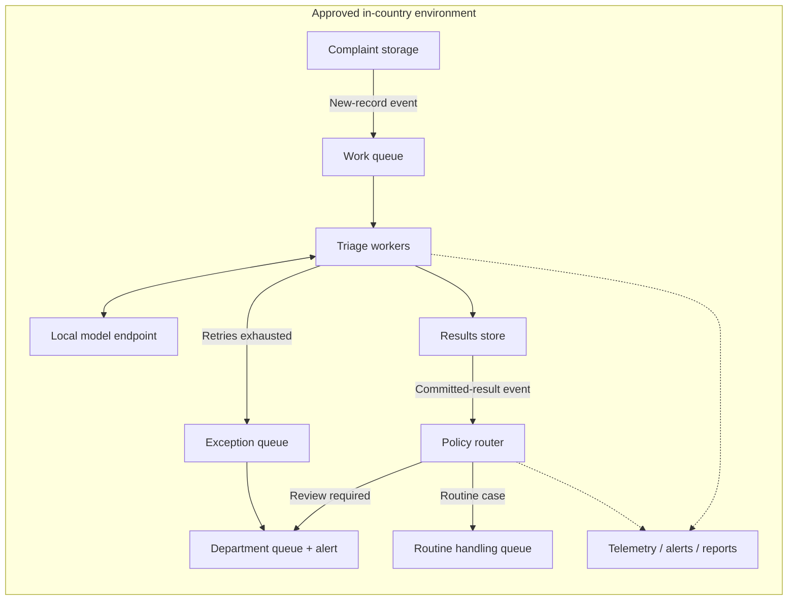

# Production design memo: complaint triage

**To:** PayGuard CTO  
**From:** Data Science  
**Date:** 16 November 2026  
**Subject:** Phased production rollout of asynchronous complaint triage

## Recommendation

Take Part B to production as an asynchronous support-assistance service, beginning
with human-approved routing. The current prototype is not ready for unattended
decisions: urgency accuracy was 80%, below the 90% majority baseline, and summary
grounding still needs human adjudication. Re-evaluate the model selected for
in-country hosting; the hosted prototype's results do not transfer automatically.

## Architecture

The [AWS architecture example](AWS_Architecture_Example.md) maps this design to
specific services, including notification, monitoring and reporting paths.

Object events enqueue record references, not complaint bodies. Serverless or
container workers scale within the model endpoint's capacity, applying local
PII masking, injection screening, schema validation and escalation rules.
Persist status, decision, model/prompt version and audit references before
routing. Treat event delivery as
[at least once](https://docs.aws.amazon.com/AmazonS3/latest/userguide/EventNotifications.html):
use a complaint/version key, conditional writes and deduplicated delivery
records to prevent repeated processing from creating duplicate tickets or emails.
Bound retries; exhausted jobs enter an exception queue and manual recovery.

Route by category and urgency, with fraud allegations, legal threats, ambiguity,
failures and high urgency requiring review. Notifications contain only an ID,
urgency, route and authenticated case link. The support queue is the system of
record; email is an alert. `requires_human=false` is necessary but insufficient
for automation: only policy-allowlisted routine cases qualify. Their queue may
later feed a separately validated answer-drafting service; this rollout does
not authorize automatic replies or closure.

## Monitoring and operational ownership

Use [OpenTelemetry](https://opentelemetry.io/docs/concepts/signals/) traces,
metrics and structured severity-based logs, correlated by opaque job IDs.
Keep complaint text, prompts, responses and secrets out of telemetry.

| What can break silently | Detection and response |
|---|---|
| A record is stored but never processed, or routing fails after inference | Reconcile intake, result and delivery states; monitor oldest-job age and exception queues. Replay safely and notify the on-call engineer. |
| Valid JSON conceals misrouting, missed urgency or unsupported claims | Weekly human audits of routine routes and sensitive cases; compare corrections, escalation recall, urgency confusion and groundedness by route/language. Breached error budgets disable automation. |
| Drift, excessive deferral or masking removes useful context | Track category/review distributions and redaction rates; authorized reviewers compare masked inputs with originals and investigate shifts. |

Proposed operational alerts: any exhausted job, oldest queued job over 15
minutes, or processing failures above 5% over 15 minutes; Support must ratify
response-time targets. Send daily completion/backlog, latency, retry and token
reports, plus weekly quality and cost reviews. Include failed calls where usage
is available; flag incomplete accounting rather than reporting a false total.
Version changes require regression evaluation; a kill switch returns all cases
to manual routing.

## Privacy, residency and retention

Keep storage, queues, compute, inference, telemetry, backups, notifications and
administrative access within approved in-country arrangements. A nearby foreign
region is insufficient. If no suitable domestic cloud region exists, use
approved domestic hosting or on-premises infrastructure. Do not send production
complaints to the prototype's global model endpoints without verified in-country
processing, retention and support arrangements; do not fall back across borders.

Mask identifiers locally before any model call, retaining originals and any
re-identification mapping under restricted access. Masked narratives remain
sensitive. Encrypt transport with TLS and data at rest with managed keys;
apply least-privilege access and audit privileged reads. Disable provider
training and request-content logging through approved configuration/contracts.

Compliance must approve separate retention periods for originals,
decisions/corrections and telemetry. Thirty days could be a staging-copy limit,
not an assumed regulatory requirement. Apply lifecycle deletion across object
versions, database records, exception queues and defined backup expiry; verify
deletion and honor approved holds. Successful processing alone must not erase
records needed for case resolution or audit.

## Rollout

Timing is indicative; evidence and business sign-off govern progression.

| Phase | Operation and exit gate |
|---|---|
| Offline, 1–2 weeks | Label representative payments complaints and targeted sensitive cases; test masking, local inference and failures. Support approves the rubric, risk budgets and acceptance criteria before scoring. |
| Shadow, at least 2 weeks | Mirror live traffic without changing routing. Compare with adjudicated support decisions; exit when quality meets the agreed budgets and delivery/backlog behavior is reliable at expected load. |
| Human-in-the-loop, 2–4 weeks | Agents approve or correct category, urgency and summary before routing. Capture corrections and reasons; exit after sustained low correction rates, reliable sensitive-case escalation and measured handling-time reduction. |
| Selective automation | Canary one validated low-risk route, retain random human audits and expand only while misrouting stays within budget and net handling savings persist. Sensitive and uncertain cases stay manual; regressions trigger rollback. |

## Dependencies on PayGuard

**Support Operations** must own taxonomy, urgency, escalation rules, reviewers
and acceptable error/response-time budgets. **Data** must provide representative
complaints and historical decisions/outcomes for controlled evaluation.
**Engineering and Infrastructure** must supply approved local inference capacity,
case-system integration and operational support. **Security and Compliance**
must approve residency, access, retention and vendor arrangements. A named
**business owner and engineering on-call owner** must review failures, costs,
quality and proposed automation changes.
